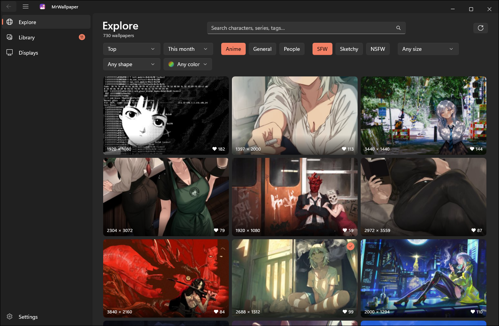
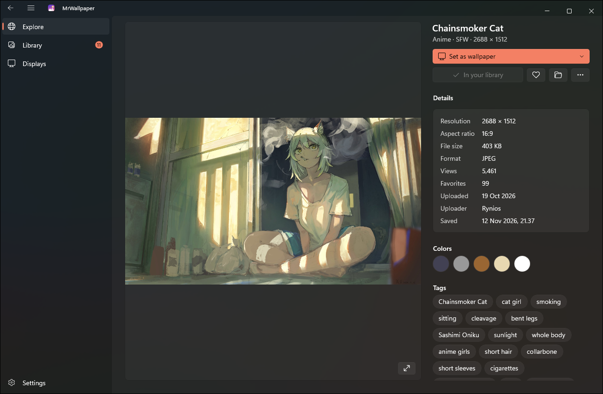
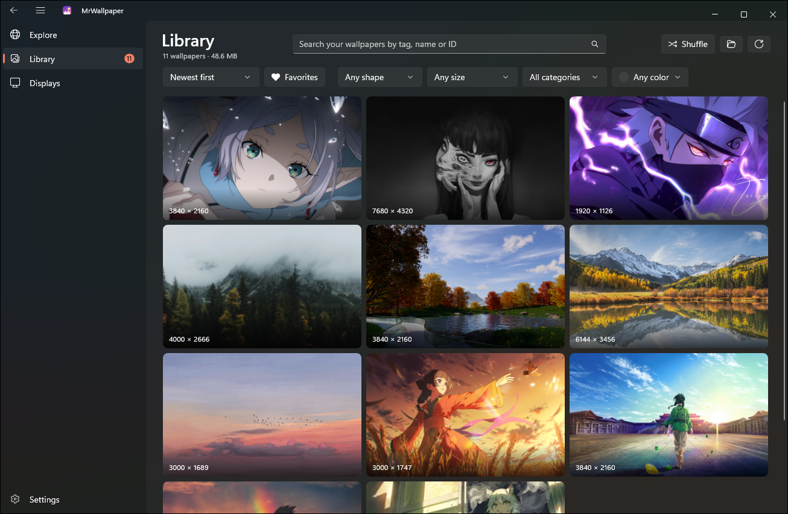
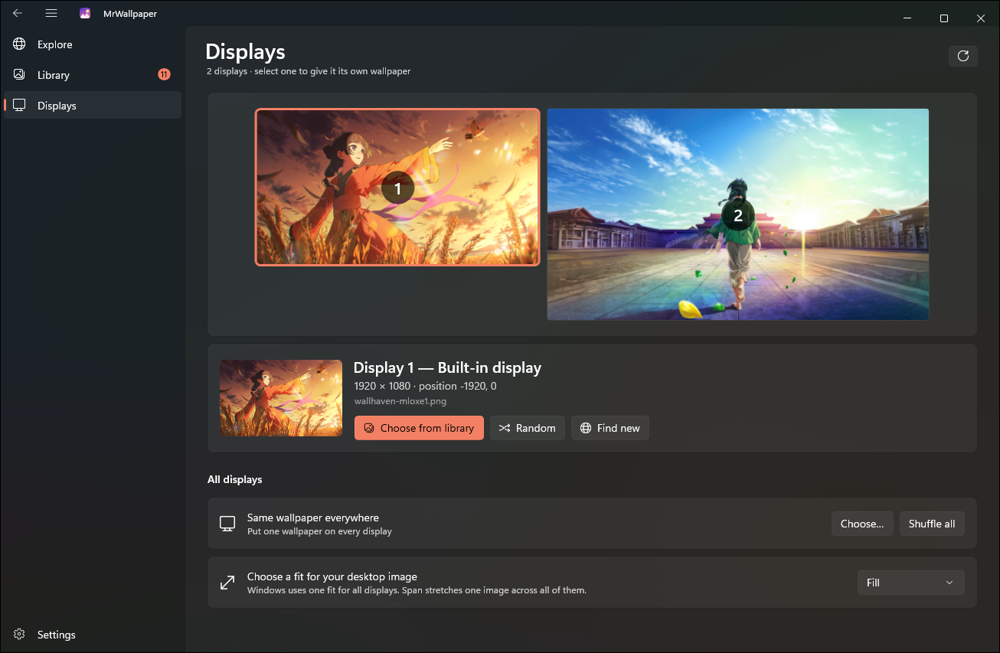
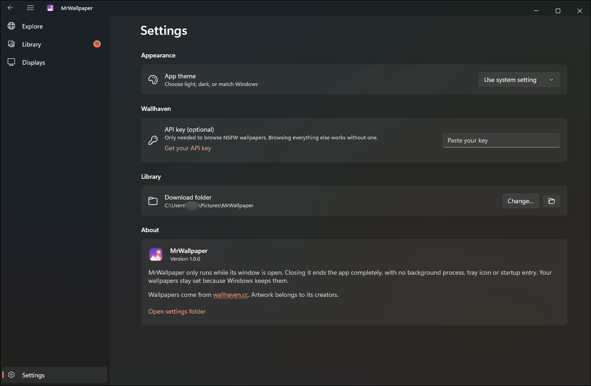

<p align="center">
  
</p>

<h1 align="center">MrWallpaper</h1>

<p align="center">
  <strong>Anime wallpapers for every display — a native Windows 11 app.</strong>
</p>

<p align="center">
  
  
  
  <a href="LICENSE"></a>
</p>

<p align="center">
  <a href="#install">Install</a> ·
  <a href="#features">Features</a> ·
  <a href="#screenshots">Screenshots</a> ·
  <a href="#building-from-source">Build from source</a>
</p>

---

A Windows wallpaper app built with WinUI 3. Browse anime wallpapers from [Wallhaven](https://wallhaven.cc), keep the ones you like in a searchable library, and give each of your monitors its own wallpaper.

MrWallpaper only runs while its window is open. Closing it ends the app completely: there's no background process, tray icon or startup entry. Your wallpapers stay set because Windows keeps them.



## Screenshots

| Wallpaper details | Library |
|---|---|
|  |  |
| **Displays** | **Settings** |
|  |  |

## Features

**Explore**
- Endless-scrolling grid of wallpapers from Wallhaven, anime by default
- Search by character, series or tag
- Filters: sort order (Top, Hot, Latest, Most viewed, Most favorited, Random, Best match) and time range; category (Anime, General, People); content rating (SFW, Sketchy, NSFW); minimum size, including "Fits my displays"; shape (landscape, portrait, 16:9, 16:10, ultrawide, 4:3); main color
- Right-click any tile to set it as your wallpaper, save it, open it on Wallhaven, or copy its link

**Wallpaper details**
- Large preview (double-click to switch between fit and fill)
- Resolution, aspect ratio, file size, format, views, favorites, upload date and uploader
- Click a color or tag to find similar wallpapers

**Library**
- Saved wallpapers go to `Pictures\MrWallpaper`, along with their tags and colors
- Search by tag, name or ID; filter by favorites, shape, size, category and color; sort by date, resolution, file size or name
- Images you copy into the folder yourself show up automatically
- Shuffle puts a random wallpaper on every display
- Deleting moves files to the Recycle Bin

**Displays**
- Shows your monitors arranged the way Windows has them, with real monitor names
- A different wallpaper on each display, chosen from your library or at random
- Choose how the image fits: Fill, Fit, Stretch, Tile, Center or Span

**Feels like part of Windows**
- Mica background, Windows 11 controls, and light, dark or system theme
- Works with keyboard and screen readers
- Remembers the window size, and suggests your past searches (remove any with ✕)

## Install

Run `MrWallpaper-Setup.msi`.

- It installs just for your user account, in `%LocalAppData%\Programs\MrWallpaper`, so it doesn't need administrator rights.
- It adds a Start menu shortcut and an uninstall entry in **Settings → Apps**.
- .NET and the Windows App SDK runtime are bundled, so you don't need to install anything else.
- Uninstalling keeps the wallpapers you downloaded.

The installer isn't code-signed, so Windows SmartScreen may warn you the first time. Choose **More info → Run anyway**.

**Requirements:** Windows 10 version 1809 or later, or Windows 11, on x64. It has been tested on Windows 11.

## Using it

| Shortcut | Action |
|---|---|
| `Ctrl+F` | Jump to the search box (Explore, Library) |
| `F5` | Refresh results, rescan the library folder, or reload displays |
| Double-click the preview | Switch between fit and fill |
| Right-click a tile | Quick actions |

**NSFW content** needs a free Wallhaven API key. Get one from your [Wallhaven account settings](https://wallhaven.cc/settings/account) and paste it into **Settings → Wallhaven**. Everything else works without a key.

### Where your data is stored

| What | Where |
|---|---|
| Downloaded wallpapers | `Pictures\MrWallpaper` (you can change this in Settings) |
| Settings and library index | `%LocalAppData%\MrWallpaper` |

Your API key is stored in plain text in `%LocalAppData%\MrWallpaper\settings.json`. The app only connects to wallhaven.cc.

## Building from source

You need Windows and the [.NET 10 SDK](https://dotnet.microsoft.com/download). Everything else (the Windows App SDK and the WiX installer tools) comes from NuGet during the build.

```powershell
# Build and run
cd MrWallpaper
dotnet build -p:Platform=x64
.\bin\x64\Debug\net10.0-windows10.0.26100.0\win-x64\MrWallpaper.exe
```

```powershell
# Build the installer: artifacts\installer\MrWallpaper-Setup.msi
.\build-installer.ps1
```

`build-installer.ps1` publishes a self-contained, trimmed Release build to `artifacts\publish` and then packages it with WiX.

## Project layout

```
MrWallpaper/            The app (C#, WinUI 3, Windows App SDK)
  Views/                Explore, Detail, Library, Displays and Settings pages
  Services/             Wallhaven API client, library, settings, per-monitor wallpaper (IDesktopWallpaper)
  Models/               Wallhaven API types, library items, settings
  Helpers/              Infinite-scroll feed, binding helpers, wallpaper menus, wrap panel
Installer/              WiX MSI project and the license/terms shown during setup
build-installer.ps1     Publish + build the installer
docs/screenshots/       Screenshots used in this README
```

## License

MrWallpaper is released under the [MIT License](LICENSE).

The license covers the MrWallpaper software only. Wallpapers you find or download through the app come from Wallhaven and belong to their creators, so respect the artists' rights when you use or share them.

MrWallpaper is not affiliated with Wallhaven.
